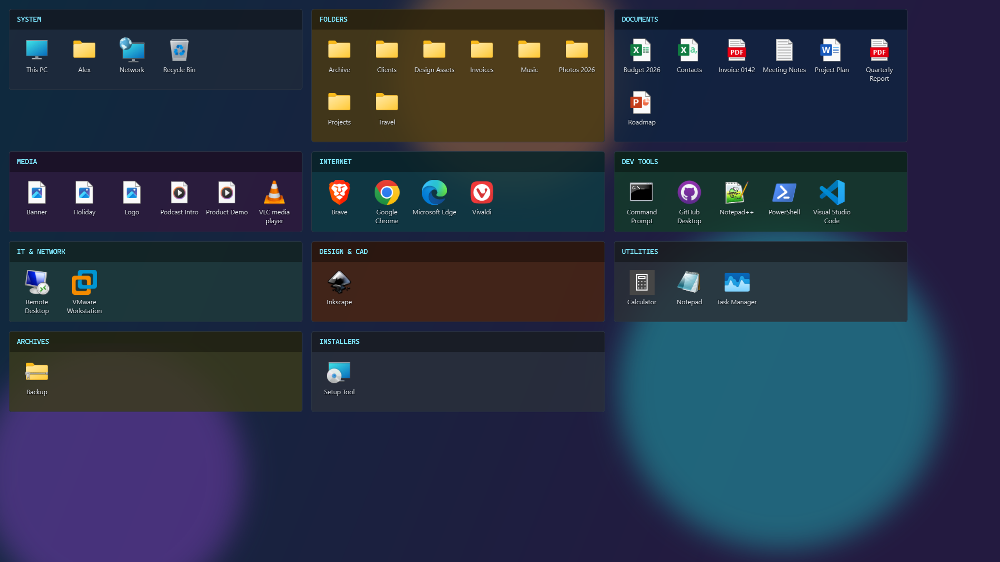
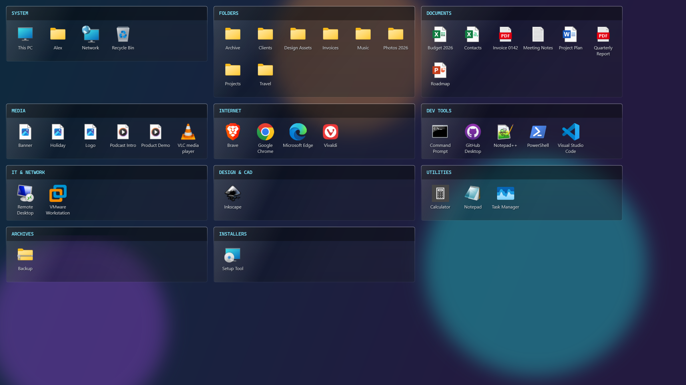
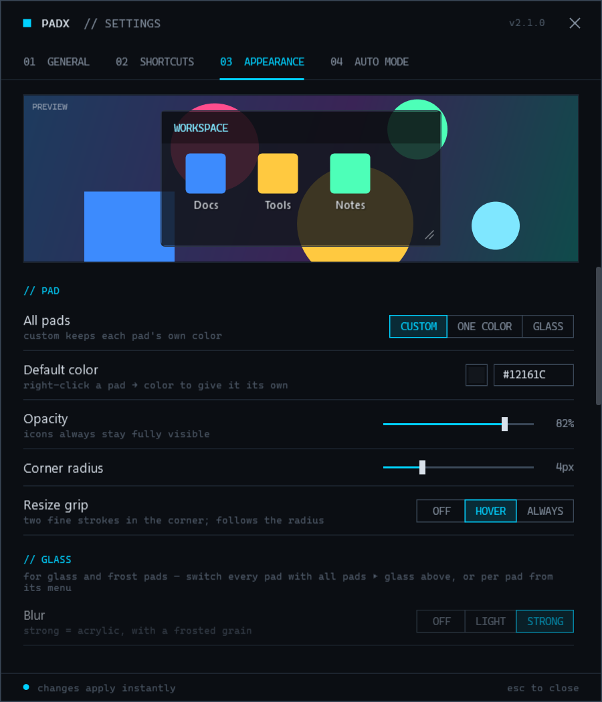
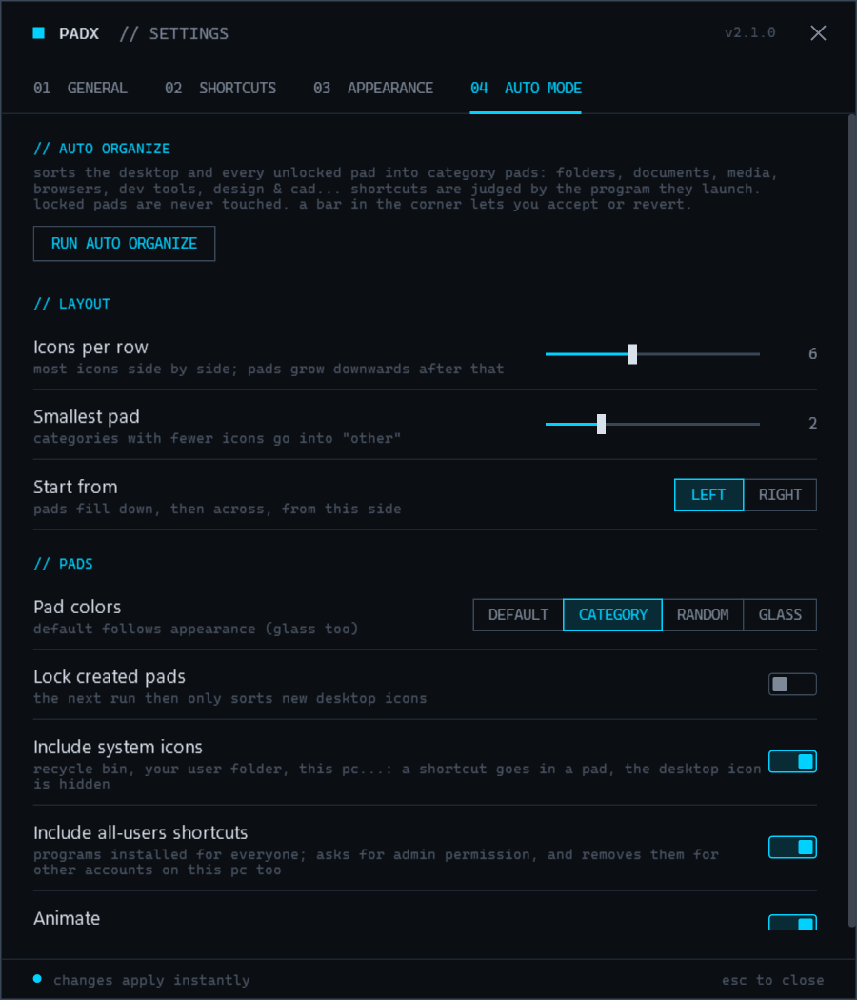
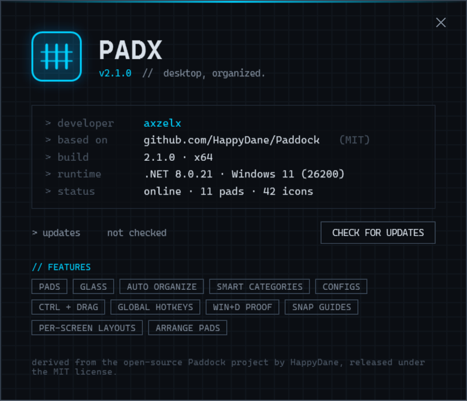

# padx

**Desktop, organized.** A free, open-source desktop icon organizer for Windows 10/11 —
pads that group your icons, sorted for you, styled the way you like.

> padx is based on [Paddock](https://github.com/HappyDane/Paddock) by HappyDane (MIT),
> and has grown well beyond it.



---

## Features

**Pads** — Group desktop icons into pads that live on the desktop: above the wallpaper,
always below your apps, never stealing focus. Move by the title bar, resize from the corner,
double-click the title to roll a pad up. Win+D (show desktop) keeps them visible.

**Your files stay where they are** — A pad only shows items; every file stays in your Desktop
folder. Paths keep working everywhere (shortcuts, the Run box, links in documents) and
Explorer shows your Desktop folder as it is. While padx runs, Windows' own desktop icons are
hidden; quit padx and they are back, nothing missing.

**The Desktop pad** — Whatever is in no other pad is in the Desktop pad, sorted like
*Sort by → Item type*. When it is empty it stays out of sight; when something new lands on the
desktop (a download, a new file) it pops up — sized to fit, clear of your other pads — and the
newcomers blink.

**Auto Organize** — One click sorts the whole desktop into category pads: System, Folders,
Documents, Media, Office, Internet, Communication, Dev Tools, IT & Network, Design & CAD,
Games, Utilities, Installers… Pads are sized to fit their icons exactly and laid out as a
tidy table — aligned rows, aligned columns, even gaps. Locked pads are left alone.
An **Accept / Revert** bar lets you undo the whole thing. No file is moved, ever.

**Smart categories, fully offline** — Shortcuts are judged by what they launch, not just
their name: the target program, its product and company info, the real target of MSI
"advertised" shortcuts, and game-engine detection (Unity, Unreal, Steam) for games no list
could know. Built-in icons (This PC, Recycle Bin, your user folder) get their own System pad;
shortcuts installed for all users are included too.

**Look** — A minimalist "digital" style throughout. Per-pad colours, plus **Glass** and
**Frost** materials with real blur-behind, adjustable tint and shine. Global opacity, corner
radius, edge colour and thickness, title bar colour/opacity/font/size/alignment, icon size,
desktop-style label shadows, an optional resize grip — all with a live preview.

**Configs** — Save the whole setup (settings, pads, and what is in each pad) under a name,
load it back any time, or have one load at every startup.

**Desktop search** — Press `Alt+Q` and type: everything in your pads (hidden pads too) and on
the desktop is filtered as you type, listed as *Google Chrome [INTERNET]*. Enter or a click
runs it; **Find place** brings its pad forward and blinks the icon. The last row searches
Google — your country's Google, from the Windows region. Keep the box always on screen at the
top or bottom (pads stay out of its strip), in a colour of your choice or as see-through glass.

**Languages** — English and Türkçe. By default padx follows Windows (Turkish Windows → Türkçe,
anything else → English); change it in **Settings → General → Language**. A translation is a
plain JSON file of *"English text": "translation"* pairs — see
[`src/Paddock.App/lang/tr.json`](src/Paddock.App/lang/tr.json). To add a language, put e.g.
`de.json` in a `lang` folder next to `padx.exe` (or send it as a pull request).

**Everyday comfort** — Ctrl + drag on empty desktop draws a new pad. The × hides a pad
(bring hidden pads back from the tray or with a hotkey); on an empty pad it deletes the pad.
Rename items inside pads — the real file is renamed. Open pad icons with a single or a double
click. Configurable global hotkeys. padx appears right at sign-in.

## Screenshots

| Glass pads | Settings — Appearance |
|---|---|
|  |  |

| Settings — Auto Mode | About |
|---|---|
|  |  |

All screenshots are generated from a throwaway demo desktop, so they never show anyone's
real files — regenerate them with:

```bash
padx.exe --screenshots docs/screenshots
```

(In the real app, glass pads also blur the wallpaper behind them; a rendered image can't
capture that live Windows effect.)

## How icons work

- **Nothing moves.** Every item stays in your Desktop folder; a pad only remembers which items
  it shows. Renaming, opening, editing, *Add to archive*… all act on the real file.
- **While padx runs**, Windows' own desktop icons are hidden (the desktop itself — wallpaper,
  right-click menu, *New* — works as always), and every item is in a pad: what you did not put
  anywhere is in the Desktop pad.
- **Renames and deletions** made elsewhere (Explorer, an installer, an app saving a file) are
  followed: pads point at the new name, and let go of what is gone.
- **Quit padx** and Windows shows its icons again — every file is right where it always was.
- **Upgrading from 2.x:** versions before 3.0 moved pad items into a hidden
  `Desktop\.Paddock` folder. padx 3 moves them back onto the desktop once, and the pads keep
  showing them.

## Download

Get the latest version from **[Releases](https://github.com/serkanyardim/padx/releases)**:

- **`padx-setup-v<version>.exe`** — installer. Installs for your user only (no administrator
  rights) and adds a Start menu entry.
- **`padx-v<version>-portable.exe`** — the app itself, nothing to install.

Requires Windows 10 (1903+) or Windows 11, 64-bit. Nothing else — .NET is built in.

> **"Windows protected your PC"?** padx is not code-signed yet (signing certificates are
> costly for a free project), so Microsoft SmartScreen warns about any new, unsigned app.
> Click **More info → Run anyway**. The code is all here to read, and each release lists
> the SHA-256 hash of its files so you can check your download.

## Installation

1. Open the latest **[Release](https://github.com/serkanyardim/padx/releases/latest)** and, under
   **Assets**, download **`padx-setup-v<version>.exe`**.
2. Run it. If Windows shows **"Windows protected your PC"**, click **More info**, then
   **Run anyway** (see the note above).
3. Pick a language (English or Türkçe), accept the MIT license, and click **Install**.
   No administrator rights are needed: padx installs to `%LocalAppData%\Programs\padx`.
4. Leave **Launch padx** ticked and click **Finish**.

padx now runs in the **system tray** (next to the clock — click **^** if you don't see its
blue icon). Right-click the icon to get started:

- **Auto Organize** — sorts your whole desktop into pads in one go (you can Accept or Revert).
- **New Pad** — draw a pad yourself; or hold **Ctrl** and drag on empty desktop.
- **Settings** — colours, glass, shortcuts, startup and more.

padx starts with Windows by default; turn that off in **Settings → General**.

**Portable instead?** Download **`padx-v<version>-portable.exe`**, put it anywhere, and run it.
Nothing is installed.

**Updating:** run the newer setup file; it replaces the old version and keeps your pads and settings.

**Uninstalling:** **Settings → Apps → Installed apps → padx → Uninstall**. Your files never
left the desktop, so once padx is gone Windows shows them all as before.

## Building from source

**Requirements:** Windows 10 (1903+) or Windows 11, [.NET 8 SDK](https://dotnet.microsoft.com/download/dotnet/8.0).

```bash
git clone https://github.com/serkanyardim/padx.git
cd padx
dotnet build
dotnet run --project src/Paddock.App
```

Release build — installer and portable exe, named with the version, in `artifacts\`.
Only for building the installer yourself: it needs [Inno Setup 6](https://jrsoftware.org/isinfo.php)
(`winget install JRSoftware.InnoSetup`). People who install padx don't need it.

```powershell
.\build-release.ps1
```

padx lives in the system tray: right-click it for **New Pad**, **Auto Organize**, **Config**,
**Settings** and **About**.

## Default shortcuts

| Action | Keys |
|---|---|
| Search the desktop | `Alt+Q` |
| Show / hide pads | `Ctrl+F12` |
| New pad | `Ctrl+Alt+N` |
| Roll up / expand all pads | `Ctrl+Alt+R` |
| Show hidden pads | `Ctrl+Alt+H` |
| Open settings | `Ctrl+Alt+P` |
| Draw a pad on the desktop | `Ctrl` + drag on empty desktop |

All of them can be changed in **Settings → Shortcuts**.

## Where things are kept

- Settings, log, saved configs and the stand-ins for built-in icons (This PC, Recycle Bin…):
  `%LocalAppData%\padx\`
- Pad contents: nowhere special — every item stays where it is, in your Desktop folder.
  A pad only remembers which items it shows.

## Project structure

```
src/
  Paddock.App/        WPF application (views, view models, styles)
  Paddock.Core/       Core logic, no UI: models, categorizer, layout planner, configs
  Paddock.Shell/      Windows integration: P/Invoke, COM, shell, hooks
tests/
  Paddock.Core.Tests/ Unit tests (xUnit)
```

The internal project and folder names still say *Paddock*; keeping them means existing
settings, configs and pad contents carry over untouched.

## Credits

- **padx** — developed by axzelx.
- Based on **[Paddock](https://github.com/HappyDane/Paddock)** by HappyDane, released under the MIT license.

## License

MIT — see [LICENSE](LICENSE).
